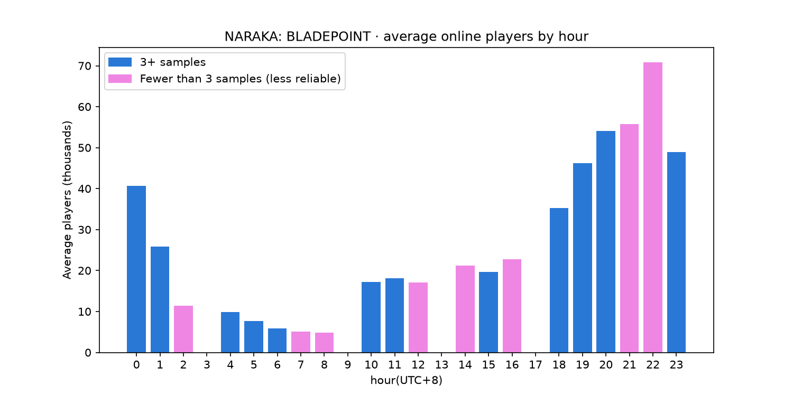

# Steam 游戏在线人数抓取

[English](README.md) | **中文**

这是一个通过 GitHub Actions 自动运行的 Steam 游戏在线人数抓取脚本(每 3 小时一次,每 3 天覆盖一天中的全部 24 个小时),利用 SQLite 存储数据。

[](https://github.com/07-teh/steam-pipeline/actions/workflows/fetch.yml)

## 为什么做这个

我是 NARAKA: BLADEPOINT 的忠实玩家,但这几年明显感觉匹配时间越来越长,玩家似乎在不断流失。我想知道它现在每天到底有多少人在线,以及一天里哪个时段人最多,这样就能挑高峰期上线,减少匹配等待。

顺带也记录了我在玩的几款魂系游戏和一些热门游戏,其中包括几款 Steam 上的头部游戏,放在一起能大致看出头部游戏的日常在线规模。目前每次拉取数据,Counter-Strike 2 的在线人数都遥遥领先。

另外,这也是一个锻炼自己实操能力的练手项目。

## 工作流程

1. 连接数据库;如果表和视图还不存在,自动创建。
2. 记录本次运行的 UTC 时间。
3. 按照游戏列表的顺序,逐个向 Steam 拉取在线人数。
4. 请求失败时自动重试:最多尝试 3 次,两次之间分别等待 2 秒、4 秒,每次翻倍(指数退避,exponential backoff)。
5. 无论结果如何,每款游戏都写入一条记录:
   - 成功:status 记为 `ok`,存入在线人数;
   - 接口没有返回有效数据:status 记为 `no_data`,人数留空;
   - 重试后仍然失败:status 记为 `failed`,人数留空。
6. 每处理完一款游戏,休息 1 秒,避免请求过密。
7. 全部处理完后,Actions 把更新后的 `steam.db` 提交回仓库,然后关闭虚拟机。

如果所有游戏都抓取失败,脚本会以退出码 1 结束,Actions 显示为失败,GitHub 会发邮件通知。失败的记录照样会提交。

## 本地运行

第一次运行需要先配置环境:创建虚拟环境,并安装依赖。

```bash
python3 -m venv .venv
source .venv/bin/activate
pip install -r requirements.txt
```

之后只需激活虚拟环境(VS Code 的内置终端会自动激活),直接运行:

```bash
python fetch_players.py
```

注意:本地运行会修改 `steam.db`。提交代码前先用 `git checkout -- steam.db` 还原,避免和 Actions 的自动提交冲突。

## 数据说明

数据存在 `player_counts` 表中,每条记录包含以下字段:

| 字段 | 说明 |
|------|------|
| id | 自增主键 |
| app_id | Steam 游戏编号,游戏改名也不会变 |
| game_name | 游戏名,在脚本里手动维护 |
| player_count | 在线人数;status 不是 `ok` 时为空(NULL) |
| fetched_at | 抓取时间,UTC,ISO 8601 格式 |
| status | `ok` / `no_data` / `failed` |

另外有一个视图 `player_counts_local`,把抓取时间转换成马来西亚时间(UTC+8),查询时可以直接使用。

**为什么时间存 UTC:** 脚本平时在 GitHub Actions 上运行,那台机器在美国;我在本地手动运行时又是马来西亚时间。如果各自存本地时间,数据里就会混着不同时区,比较和计算都容易出错。统一存 UTC,所有记录都在同一个标准上;需要看马来西亚时间时,查询 `player_counts_local` 视图即可。

**为什么需要 status:** 0 本身也是一个数据,代表当时在线人数真的是 0。如果把 `no_data` 或 `failed` 也存成 0,就分不清"真的没人在线"和"根本没拿到数据"。后期计算平均值时,这些假的 0 会把结果拉低,造成很大的误差。

## 分析结果

### NARAKA: BLADEPOINT 一天中什么时候人最多



- **晚上 7 点到 11 点人最多**,平均 4.6 万到 7 万人;晚上 10 点过后开始回落。
- **清晨 5 点到 8 点人最少**,平均只有 5 千到 8 千人,不到高峰期的五分之一。
- 想减少匹配等待,最好在晚上 7 点到 11 点上线。

**数据说明:**

- 时间范围:2026-09-23 至 2026-10-15(马来西亚时间),共 85 次抓取。
- 已排除可疑的 0(见下方「6 款游戏同时返回 0」)。
- 图例标为 *Fewer than 3 samples* 的柱子,该小时的数据少于 3 次,平均值参考价值较低。
- 3、9、13、17 点目前还没有数据。调整排程后(见下方「GitHub Actions 定时任务不准时」),这些时段会陆续补上。
- Steam 返回的缓存值还没有去重,这是下一步要处理的。

图表由 `analyze.py` 生成,重新运行即可用最新数据更新:

```bash
python analyze.py
```

## 遇到过的问题

### NARAKA 请求失败(2026-09-23)

**现象:** 刚开始写脚本、还没上传到 GitHub 时,抓取 NARAKA: BLADEPOINT 返回失败,报错为 `Errno 61 Connection refused`。错误发生在建立连接的阶段,请求根本没有发出去——可能是网络抖动,也可能是 Steam 暂时拒绝了连接。

**判断:** 等了大约 1 分钟重新运行就成功了,所以判断是瞬时故障(transient failure),不是代码或接口本身的问题。

**处理:** 加入重试机制:失败后等待 2 秒、4 秒再试,最多尝试 3 次。之后没有再遇到这个问题。

### Steam 返回缓存值(2026-09-23)

**现象:** 把数据拉下来交给 AI 检查时发现,Counter-Strike 2 在 10 分钟内的三次抓取中返回了完全相同的在线人数,Wallpaper Engine 也一样。

**判断:** Steam 这个接口返回的是缓存值,不是实时数据。

**处理:** 原始数据照存不删,去重留到分析时再做,这样原始记录不会丢失。目前仍在收集数据,后续会加入去重机制。

### 没有测试就 push,导致 Actions 运行失败(2026-09-24)

**现象:** 添加本地时间视图时,因为我对 SQL 不熟悉,所以让 AI 帮忙写。AI 给的代码里有一段 `CREATE TABLE`,其中的 `...` 是留给我自己填写字段的占位符,但我没看出来,直接粘贴并 push 了,结果手动运行 Actions 时报错。

**处理:** 检查后发现是这段占位符导致的,补上完整的字段定义后重新提交,6 分钟后恢复正常。

**收获:** 之后每次 push 前,都先在本地手动运行一次。

### 6 款游戏同时返回 0(2026-10-11)

**现象:** 2026-10-11 17:08 UTC 那次抓取中,Apex Legends、GTA V、ELDEN RING、FINAL FANTASY VII、WARDOGS、Wallpaper Engine 这 6 款游戏的在线人数都是 0,status 却是 `ok`,其余 9 款正常。整个数据库里只有这 6 条记录是 0,全部来自这一次运行。

| 抓取时间(UTC) | Apex Legends | ELDEN RING |
|------|------|------|
| 10-11 11:54 | 155,744 | 32,955 |
| 10-11 17:08 | **0** | **0** |
| 10-11 21:19 | 66,837 | 28,231 |

**判断:** 这些 0 几乎可以确定是假的:

- 几万到十几万人在线的游戏,不可能突然归零,几个小时后又恢复;
- 6 款游戏在同一时刻一起变 0,另外 9 款却完全正常,更像是 Steam 那一次返回了错误数据,而不是玩家真的离开。

status 之所以是 `ok`,是因为 Steam 返回了 `result == 1`,脚本据此认为这次查询有效。

**处理:** 原始数据照存不改,留到分析阶段再过滤。不在抓取脚本里直接处理,有两个原因:

- 脚本当下分辨不了真的 0 和假的 0,冷门游戏确实可能在某个时段 0 人在线;
- 在分析阶段过滤是可以反悔的,规则随时能调;在脚本里改掉,原始记录就回不来了。

**收获:** status 是 `ok`,不代表数字就是对的。接口说成功,也要检查返回的数值是否合理。

### GitHub Actions 定时任务不准时(2026-10-14)

**现象:** 原本的排程 `0 */6 * * *` 应该在 UTC 0、6、12、18 点各运行一次,实际却经常推迟,最多晚了将近 3 小时(10-14 00:00 那次到 02:58 才运行);有时甚至直接跳过(10-13 12:00 那次没有运行)。

**判断:** 经过观察,这是 GitHub Actions 本身的限制。免费的定时任务共用一个排队系统,官方不保证准时;整点又是全世界最多人设定定时任务的时间,大量任务同时触发,所以最拥挤、最不稳定。

**处理:**

- 分钟改成 13,错开整点的高峰期。
- 改成每 3 小时运行一次,并按日期分 3 组轮换起点:第 1 组从 0 点开始,第 2 组从 1 点开始,第 3 组从 2 点开始。每 3 天就能覆盖一天中的全部 24 个小时。原本的排程每天只有固定 4 个时刻,其他小时只能靠延迟「碰巧」采到。

**代价:** 每天运行次数从 4 次变成 8 次。因为每次都会整份提交 `steam.db`,仓库体积的增长会加快,之后考虑把数据改存成 CSV。

**收获:** 免费的定时服务不一定可靠,设计排程时要把平台的限制考虑进去。

## 局限与后续计划

**目前的不足:** 只采集了在线人数,能看到的东西有限。

**后续计划:**

- 加入成就、评价等更多维度的数据,整理成一套成熟、可持续的监测机制。
- 每季度、以及每次 Steam 大促前后,生成一份完整的报表,例如在线人数前 50 的游戏、2026 年发行的游戏中玩的人最多的是哪些,并做成可视化图表,让人更直观地看到数据。
- Steam 本身也有做类似的统计,但主动去了解的人太少,资料也比较分散。这份报表可以让做游戏周边的商家更直观地了解当前的热门游戏,并据此安排商品售卖。当然,它无法做到预测,只能在游戏火起来之后帮助跟进。